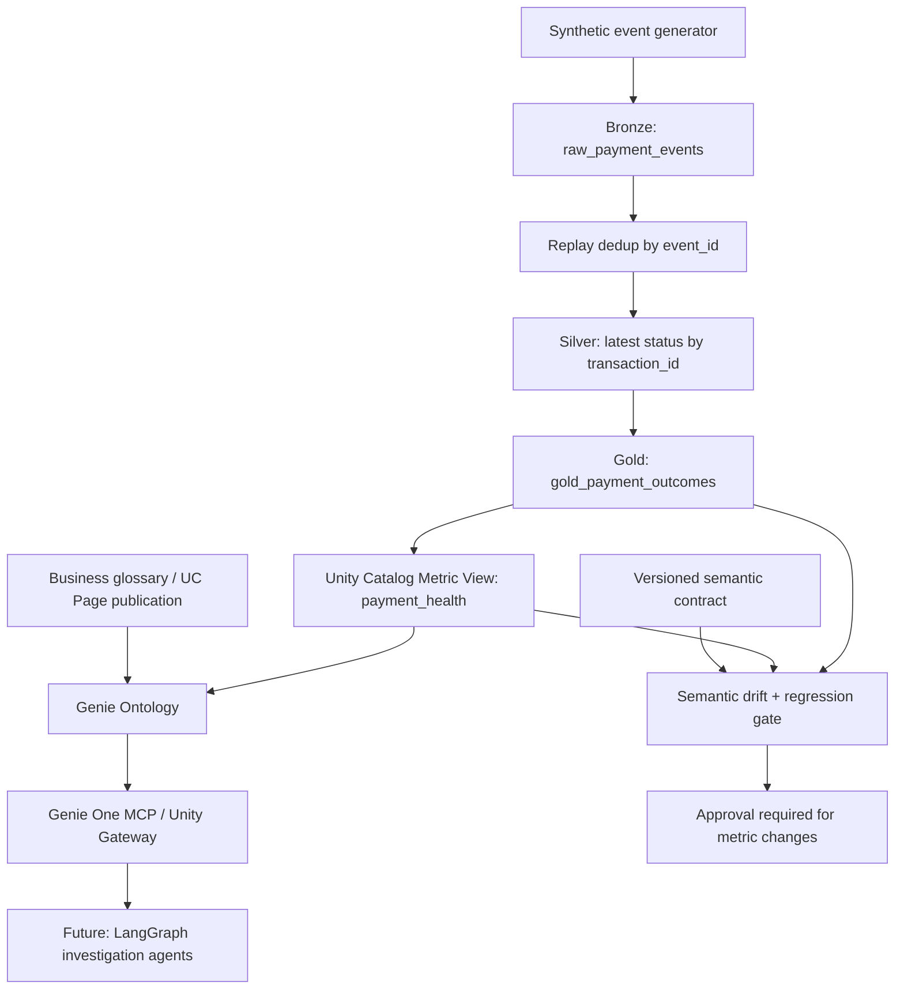

# Architecture — V0.1

## Trust boundaries

- **Local pipeline:** deterministic simulation and executable reference semantics, SQLite rather than Delta.
- **Databricks:** separate PySpark notebook for Delta tables, metric YAML/SQL DDL, and human-published UC Page.
- **Genie One:** available through Unity Gateway only after Databricks account/workspace configuration.
- **OntologyOps:** a custom portfolio engine comparing Git-managed contracts with candidate definitions and
  evaluating SQL expressions. It is **not** an undocumented Genie Ontology editing API.
- **Write protection:** no automatic semantic updates, production payment actions, credentials, or external APIs.

## Deliberate MVP tradeoffs

1. Reference snapshot instead of streaming CDC. Next increment: Kafka + Debezium + Auto Loader and Delta MERGE.
2. No simulated cross-currency FX rate: exposure always segmented by currency.
3. SQL whitespace normalization is strict change detection, not semantic equivalence proof.
4. Drift engine checks formula/source/schema changes; it cannot automatically infer business intent.
5. Local SQL expressions run on SQLite; Databricks behavior requires separate workspace validation.
6. A real Genie MCP connection requires workspace permissions, OAuth or a controlled token, and a SQL warehouse.
7. Cross-account chargebacks, partial settlements, multi-leg FX and bank cut-off calendars are out of scope.
